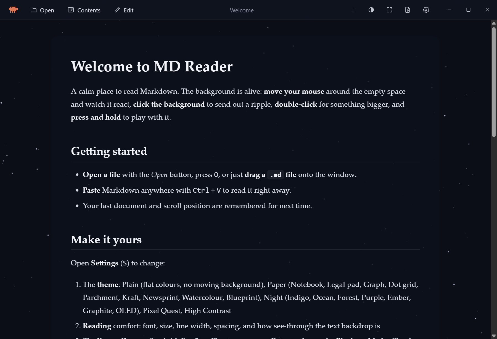

<p align="center">
  
</p>

<h1 align="center">MD Reader</h1>

<p align="center">
  <b>A calm place to read Markdown.</b><br />
  Your notes on a quiet reading column, with a live wallpaper drifting behind them.
</p>

<p align="center">
  <a href="https://github.com/Shanu-vs/clawd-reader/releases/latest"></a>
</p>

<p align="center">
  <a href="https://github.com/Shanu-vs/clawd-reader/releases/latest"></a>
  
  
  <a href="LICENSE"></a>
  <a href="https://github.com/Shanu-vs/clawd-reader/releases"></a>
</p>

<p align="center">
  
</p>

## Why MD Reader?

- **Made for long reading.** Study notes, documentation, books written in Markdown. Maths, figures, tables and a PDF-style contents sidebar all just work.
- **Calm to look at.** A starfield, fireflies, slow currents, rain on a pond, or a pixel-art world where **Claw'd** the crab wanders between places. It reacts when you click, and pauses whenever you want.
- **Tiny and quick.** A 3 MB installer that opens instantly. It uses the WebView2 already built into Windows instead of shipping a whole browser, so it stays light on memory and battery.
- **Yours, offline.** No account, no sign-in, no internet needed. Your files stay on your computer.
- **Easy on the eyes.** 27 themes: calm plain colours, real paper looks (notebook, parchment, graph paper…), warm low-blue-light, true-black OLED and High Contrast.

## Install

1. **[Download the latest `MD-Reader_…_x64-setup.exe`](https://github.com/Shanu-vs/clawd-reader/releases/latest)** from the Releases page.
2. Double-click it. If Windows says *"Windows protected your PC"*, click **More info → Run anyway**. (The app isn't code-signed yet; signing certificates cost money, so many small open-source apps show this.)
3. Click through the setup. No admin rights needed.
4. Find **MD Reader** in the Start menu or Windows search.

**Open `.md` files with a double-click:** right-click any `.md` file → **Open with → Choose another app → MD Reader**, and tick **Always**.

To uninstall: **Settings → Apps → Installed apps → MD Reader → Uninstall**.

## Is it safe?

That blue *"Windows protected your PC"* screen is fair to worry about, so here is exactly what's going on.

**Why Windows warns you.** The warning doesn't mean a virus was found. Windows shows it for any app that isn't *code-signed* (signing certificates cost a few hundred dollars a year) and hasn't been downloaded by many people yet. Every new indie app gets it, and it fades as more people install it.

**How you can check for yourself:**
- **Virus scan:** [VirusTotal report for the 0.4.0 installer](https://www.virustotal.com/gui/file/52379cf819bbdf66a56559829ffd0936b73971f9bb3ef14b7ed4648f47ca409b). 69 of 71 antivirus engines find nothing, including Microsoft Defender, Kaspersky, Bitdefender, ESET, Norton, Avast, McAfee and Malwarebytes. The other 2 (Arctic Wolf and SecureAge) are strict engines that often flag new, unsigned installers they haven't seen before; these "false positives" are common for small apps. The report is public, so you can read it yourself.
- **Same file as released:** each release lists the installer's SHA-256 checksum. In PowerShell, `Get-FileHash .\MD-Reader_0.4.0_x64-setup.exe` should print the same value.
- **Open source:** every line of code is in this repository under the [MIT licence](LICENSE). You can read it, or build the installer yourself (see [For developers](#for-developers)).

**What the app does and doesn't do:**
- It opens only the Markdown files you choose, and the pictures they link to.
- It writes to a file only when you press **Save**.
- It has no account, no ads, no analytics and no auto-updater. The app is locked so it **can't send data anywhere** (its content security policy blocks all network requests). The only things it may download are pictures that your own document links to on the web.
- It installs just for your user, with no admin rights, and the uninstaller removes it. Tick *"Delete the application data"* there to remove your settings too.

## Screenshots

| Pixel world (Pixel Quest theme) | Study notes with the contents panel |
| --- | --- |
|  |  |

| Light theme with settings docked |
| --- |
|  |

## Features

### Reading
- Open with the **Open** button, a **double-click in Explorer**, drag a file onto the window, or paste Markdown with `Ctrl+V`.
- **Maths** with KaTeX: `$inline$` and `$$ display $$` equations, with optional numbers like `$$[3.5]`.
- **Numbered figures** from images that sit alone in a paragraph. The alt text becomes the caption, and `{width=70}` sets the size. Pictures next to the file load straight from disk.
- **Table captions** with a `Table: …` line above a table, plus a **title block** from `% title:` / `% subtitle:` lines.
- Syntax-highlighted code, task lists, block quotes, reading time and a progress bar.
- **Diagrams** with Mermaid: flowcharts, sequence diagrams, timelines, mind maps, Gantt and pie charts. They follow your light or dark theme and work offline.
- **Callouts** like GitHub and Obsidian: `> [!NOTE]`, `[!TIP]`, `[!IMPORTANT]`, `[!WARNING]`, `[!CAUTION]`, foldable with `+` / `-`.
- **Footnotes**, ==highlights== (`==text==`), H~2~O-style subscripts and x^2^ superscripts, definition lists and `:emoji:` codes.
- **Chemistry** with `$\ce{H2O}$`, and GitHub-style ` ```math ` blocks.
- **Front matter** (the `---` block at the top of Obsidian, Jekyll and Hugo notes) is hidden, and its title is used.
- **Wiki links**: `[[Other note]]`, `[[Note#Heading]]` and links to other `.md` files open that note; **Alt + ←** goes back. `![[picture.png]]` shows a picture.
- **Contents panel** like a PDF viewer's sidebar: collapsible chapters that follow your place, and a Figures tab with thumbnails.
- The page **fits the window** (adjustable width), with an optional comfortable line length.
- Your last document and scroll position are remembered.

### Editing
- Documents always open for reading. Press **Edit** and the page becomes its Markdown source.
- The button becomes **Save**, and its ▾ menu has **Save as…** and **Stop editing**.
- Saving is safe: it writes to a temporary file first and keeps your file's line endings.
- The app warns you before unsaved changes would be lost.

### Themes
- **Plain**: calm flat colours with no moving background, in White, Sepia, Sage, Rose, Sky, Lavender, Peach, Stone and Charcoal.
- **Paper**: real paper looks, in Notebook (ruled with a red margin), Legal pad, Graph, Dot grid, Parchment, Kraft, Newsprint, Watercolour and Blueprint.
- **Night**, in Indigo, Ocean, Forest, Purple, Ember (warm, low blue light), Graphite and **OLED** (true black, easy on battery and eyes at night).
- **Pixel Quest**: a chunky retro-game look with a pixel font.
- **High Contrast**.
- A one-click light/dark switch remembers your favourite of each.

### Live wallpapers
Each one has its own settings and colour palettes (Warm white, Moonlight, Aurora, Deep sea, Sunset, Ember, Lavender, Meadow, or your own colour).

| Wallpaper | Click | Double-click | Press and hold |
| --- | --- | --- | --- |
| **Starfield**: drifting, twinkling stars and shooting stars | Ripple | Supernova | Gravity well (let go to slingshot) |
| **Fireflies**: warm tones, different sizes, slow blinking | Scatter | They all light up | They gather and circle you |
| **Flowing currents**: slow, soft trails | Swirl | A wide, slow whirlpool | Drag to stir the water |
| **Rain ripples**: rings spreading on a pond | Splash | A short thunder shower | Rest a finger in the water |
| **Pixel world**: Claw'd travels through six places | Claw'd hops | Fireworks, and Claw'd waves | Magic dust follows you |

The pixel world has six places: Green Meadow, Sunny Beach, Snowy Peaks, Desert Canyon, Autumn Woods and Under the Sea. It moves on every 30 minutes (adjustable) with a smooth crossfade, and the sky follows your clock.

### Comfortable to use
- A **pause button** for the moving background (`W`). The app also follows Windows' "reduce animations" setting.
- **Focus mode** calms the wallpaper and hides the toolbar until you need it.
- A frame-rate cap (15–60 fps). The wallpaper pauses when minimised and slows while you scroll.
- **Right-click** anywhere for a quick menu: theme, wallpaper, text size, page width and more.
- The toolbar is the window's title bar, with Windows-style controls.
- **Export to PDF**: clean pages without the wallpaper, each chapter on a new page.

## Keyboard shortcuts

| Key | Action |
| --- | --- |
| `O` / `Ctrl+O` | Open a file |
| `E` | Edit the document |
| `Ctrl+S` / `Ctrl+Shift+S` | Save / Save as (while editing) |
| `Esc` | Stop editing, or close panels |
| `C` | Contents panel |
| `S` / `Ctrl+,` | Settings |
| `T` | Switch light / dark |
| `F` | Focus mode |
| `W` | Pause or play the background |
| `P` / `Ctrl+P` | Export to PDF |

## Try the sample

[`docs/sample.md`](docs/sample.md) is a short set of study notes that shows off maths, a captioned table, code and a task list. [`docs/formats.md`](docs/formats.md) is a tour of every format above: diagrams, callouts, footnotes, chemistry and more. Download them and open them in the app.

## FAQ

**Is it free?** Yes, and open source under the [MIT licence](LICENSE).

**Mac or Linux?** Windows 10 and 11 only for now.

**Why does Windows warn me when installing?** The installer isn't code-signed, so SmartScreen doesn't recognise it yet. See [Is it safe?](#is-it-safe) for the virus scan and how to check the file.

**Does it need the internet?** No. It only loads pictures from the web if your document links to them.

**Windows 10 says something about WebView2.** Windows 11 already has it. On an older Windows 10, the installer downloads it for you.

## Roadmap

- [x] Open `.md` files by double-clicking them in Explorer
- [x] Ready-made installer on the Releases page
- [ ] Reload automatically when the file changes on disk
- [ ] Recent files
- [ ] Find in document (`Ctrl+F`)
- [ ] Gentle ambient sounds to match each wallpaper

Ideas and bug reports are welcome in [Issues](https://github.com/Shanu-vs/clawd-reader/issues).

## For developers

<details>
<summary><b>Build it yourself (Windows)</b></summary>

### One-time setup

1. Install [Node.js](https://nodejs.org) (LTS).
2. Install **Microsoft C++ Build Tools** with the *Desktop development with C++* workload:
   ```bash
   winget install Microsoft.VisualStudio.2022.BuildTools --override "--wait --passive --add Microsoft.VisualStudio.Workload.VCTools --includeRecommended"
   ```
3. Install **Rust**:
   ```bash
   winget install Rustlang.Rustup
   ```
4. Install the project's dependencies:
   ```bash
   npm install
   ```

### Run

```bash
npm run app        # the desktop app, reloads as you change the code
npm run dev        # browser-only preview at http://localhost:5173
```

### Build the installer

```bash
npm run app:build
```

The setup file appears in `src-tauri/target/release/bundle/nsis/`.

</details>

<details>
<summary><b>Project layout</b></summary>

```
src/
  main.ts                 app wiring: documents, toolbar, shortcuts, drag & drop, window
  markdown.ts             Markdown -> safe HTML: maths, figures, captions, task lists
  desktop.ts              desktop-only helpers: open/save dialogs, reading and writing files
  settings.ts             typed settings with defaults, saved locally
  themes.ts               theme families and their colour variations
  ui/
    editor.ts             edit mode, Save / Save as
    contents.ts           contents sidebar (chapters and figures)
    settingsPanel.ts      settings panel, built from a list of controls
    floating.ts           movable / dockable panels
    quickMenu.ts          right-click menu
    icons.ts              toolbar and window icons
    about.ts              About box
  wallpaper/
    host.ts               runs the active wallpaper: fps cap, pause, reduced motion, gestures
    palettes.ts           colour palettes
    starfield.ts  fireflies.ts  currents.ts  rain.ts
    pixel/                the pixel world: places, scenery, weather and Claw'd
  styles/                 app, Markdown and print (PDF) styles
src-tauri/                desktop wrapper (Rust): file access, window, installer
docs/                     sample document and screenshots
```

</details>

## Licence

[MIT](LICENSE): you're free to use, change and share the code, as long as the copyright notice stays with it.

## Credits

Claw'd, the Claude crab, is Anthropic's character. This is an unofficial, fan-made project and is not affiliated with or endorsed by Anthropic.

Built with [Tauri](https://tauri.app), [Vite](https://vite.dev), [markdown-it](https://github.com/markdown-it/markdown-it), [KaTeX](https://katex.org), [highlight.js](https://highlightjs.org), [DOMPurify](https://github.com/cure53/DOMPurify) and [Pixelify Sans](https://fonts.google.com/specimen/Pixelify+Sans). The settings icon is adapted from [Feather Icons](https://feathericons.com) (MIT).
