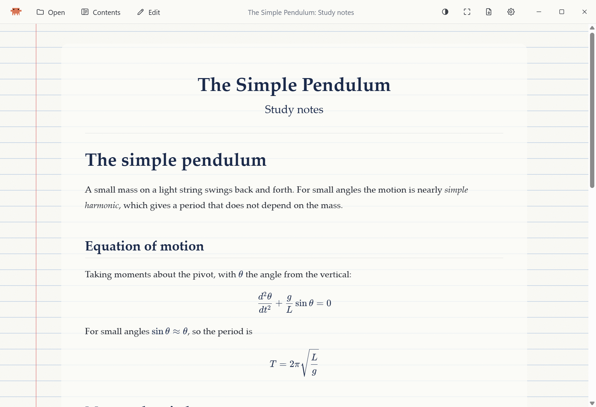
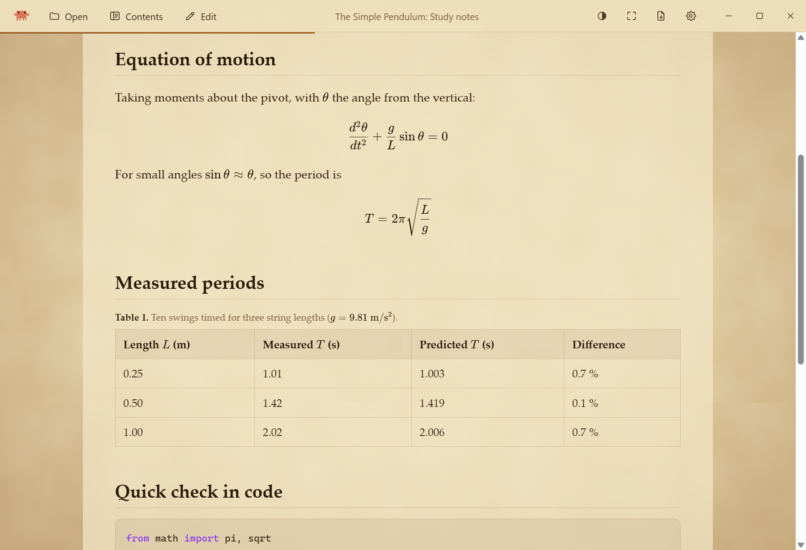
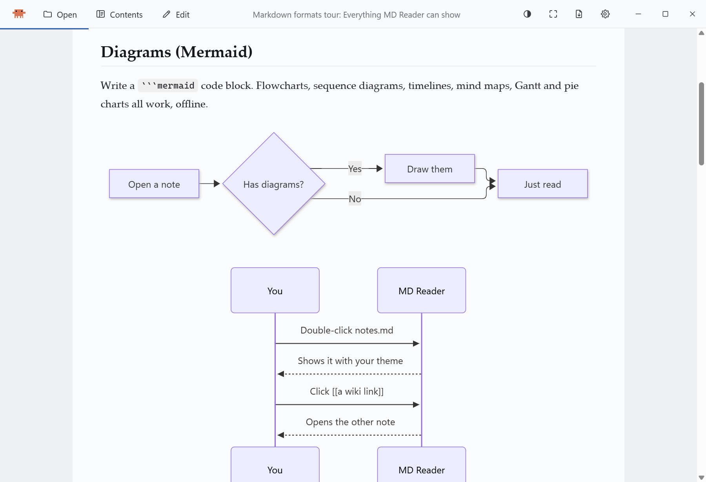
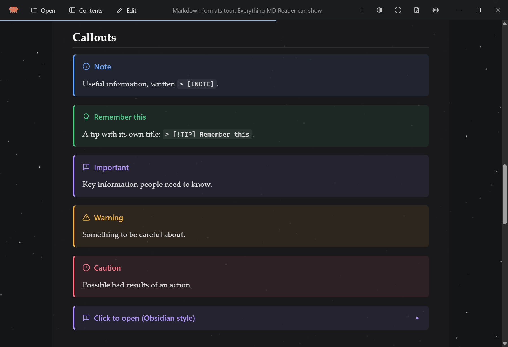
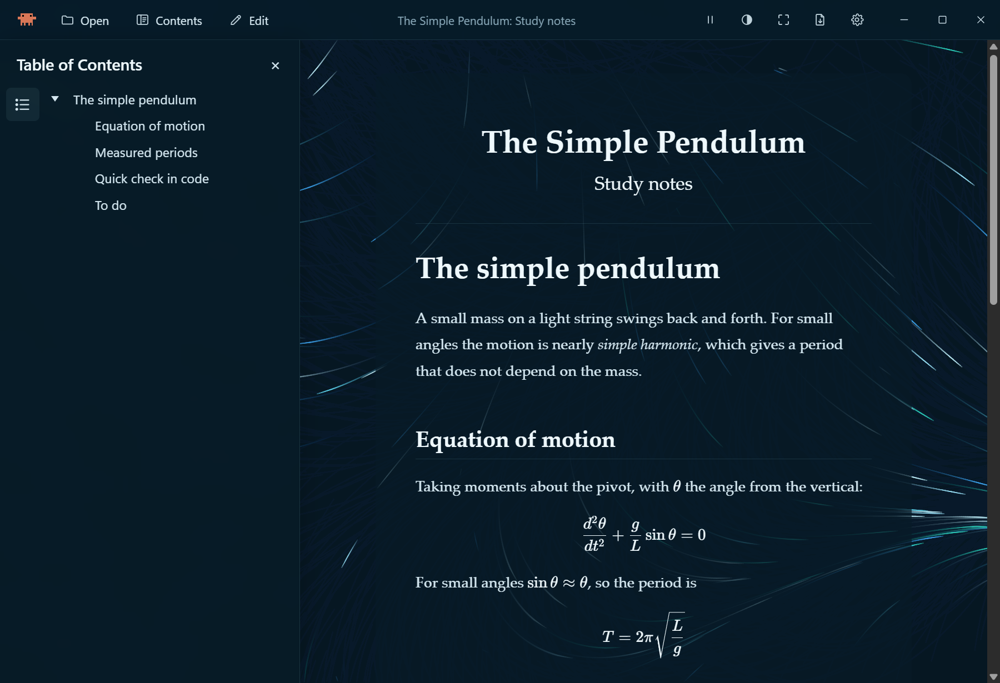
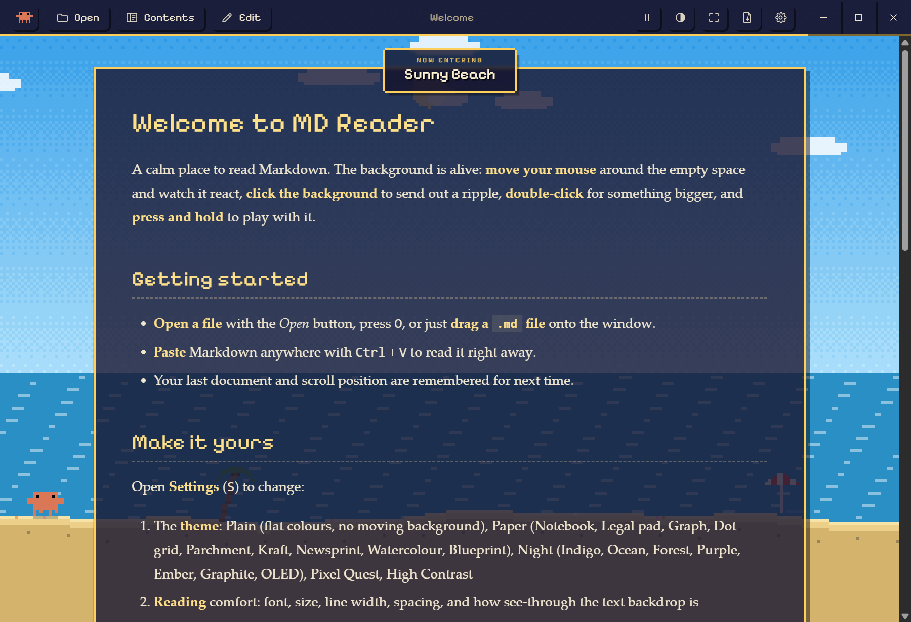
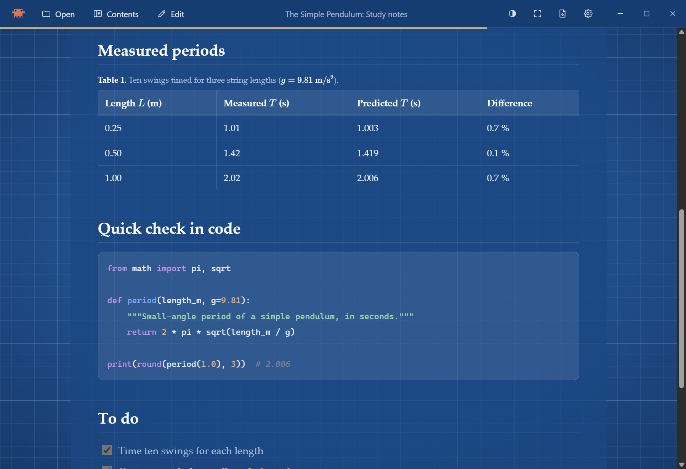
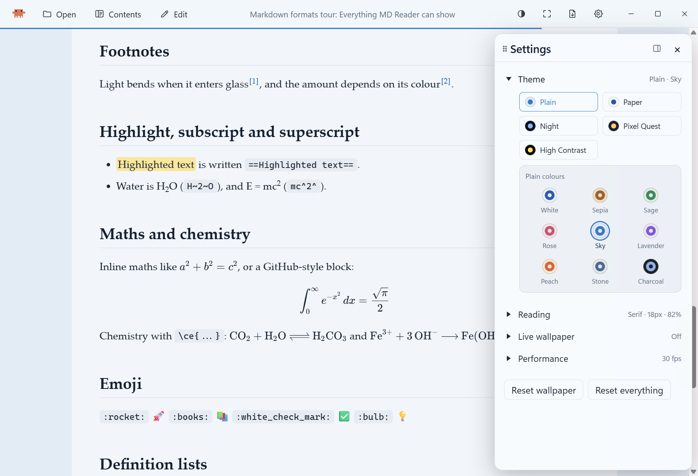

<p align="center">
  
</p>

<h1 align="center">MD Reader</h1>

<p align="center">
  <b>A calm place to read Markdown.</b><br />
  A small, offline Windows app for study notes, docs and books written in Markdown,<br />
  with maths, diagrams, paper-like themes and an optional live wallpaper behind the page.
</p>

<p align="center">
  <a href="https://github.com/Shanu-vs/md-reader/releases/latest"></a>
</p>

<p align="center">
  <a href="https://github.com/Shanu-vs/md-reader/releases/latest"></a>
  <a href="https://github.com/Shanu-vs/md-reader/releases"></a>
  
  
  <a href="LICENSE"></a>
</p>

<p align="center">
  <a href="#download">Download</a> ·
  <a href="#a-look-around">Screenshots</a> ·
  <a href="#features">Features</a> ·
  <a href="#markdown-support">Markdown support</a> ·
  <a href="#is-it-safe">Is it safe?</a> ·
  <a href="#faq">FAQ</a> ·
  <a href="CHANGELOG.md">Changelog</a> ·
  <a href="https://github.com/Shanu-vs/md-reader/issues/new/choose">Report a bug</a>
</p>

<p align="center">
  
</p>

## Why MD Reader?

- **Made for long reading.** Maths, figures, tables, diagrams and a PDF-style contents sidebar all just work, so study notes and documentation read like a finished book.
- **Calm to look at.** Choose real paper (notebook, parchment, blueprint…), a plain colour, or a gentle live wallpaper: a starfield, fireflies, slow currents, rain on a pond, or a pixel-art world where **Claw'd** the crab wanders between places.
- **Small and quick.** A 4 MB installer that opens instantly. It uses the WebView2 engine already built into Windows instead of shipping a whole browser, so it stays light on memory and battery.
- **Private and offline.** No account, no sign-in, no tracking, no internet needed. Your files stay on your computer.
- **Easy on the eyes.** 27 themes, including warm low-blue-light, true-black OLED and High Contrast.

## A look around

<table>
  <tr>
    <td width="50%"></td>
    <td width="50%"></td>
  </tr>
  <tr>
    <td align="center"><b>Notebook paper</b>, one of nine paper types</td>
    <td align="center"><b>Parchment</b> with maths and a captioned table</td>
  </tr>
  <tr>
    <td></td>
    <td></td>
  </tr>
  <tr>
    <td align="center"><b>Diagrams</b> from Mermaid code, drawn offline</td>
    <td align="center"><b>Callouts</b> as in GitHub and Obsidian</td>
  </tr>
  <tr>
    <td></td>
    <td></td>
  </tr>
  <tr>
    <td align="center"><b>Contents sidebar</b> that follows your place</td>
    <td align="center"><b>Pixel world</b>, where Claw'd travels between six places</td>
  </tr>
  <tr>
    <td></td>
    <td></td>
  </tr>
  <tr>
    <td align="center"><b>Blueprint</b>, a dark paper theme</td>
    <td align="center"><b>Settings</b> with the nine Plain colours</td>
  </tr>
</table>

## Download

| Platform | Download | Notes |
| --- | --- | --- |
| **Windows 10 / 11** (64-bit) | [**MD Reader setup (.exe)**](https://github.com/Shanu-vs/md-reader/releases/latest) | 4 MB, installs for your user only, no admin rights |
| macOS, Linux | Not yet | The app is built with Tauri, so these are possible later |

**Install**

1. Download `MD-Reader_…_x64-setup.exe` from the [latest release](https://github.com/Shanu-vs/md-reader/releases/latest).
2. Run it. If Windows says *"Windows protected your PC"*, choose **More info → Run anyway**. The installer isn't code-signed yet; see [Is it safe?](#is-it-safe).
3. Click through the setup, then find **MD Reader** in the Start menu or Windows search.

**Open `.md` files with a double-click:** right-click any `.md` file → **Open with → Choose another app → MD Reader**, and tick **Always**.

**Update:** run the newer setup file. It replaces the old version and keeps your settings.

**Uninstall:** **Settings → Apps → Installed apps → MD Reader → Uninstall**.

## Features

### Reading
- Open files with the **Open** button, a **double-click in Explorer**, by dragging a file onto the window, or paste Markdown with `Ctrl+V`.
- A **contents sidebar** like a PDF viewer's: collapsible chapters that follow your place, and a Figures tab with thumbnails.
- **Links between notes**: `[[wiki links]]` and links to other `.md` files open that note; **Alt + ←** goes back.
- The page **fits the window** (adjustable width), with an optional comfortable line length.
- Reading time, a progress bar, and your last document and scroll position remembered.
- **Export to PDF**: clean pages without the wallpaper, each chapter on a new page.

### Editing
- Documents always open for reading. Press **Edit** and the page becomes its Markdown source.
- **Save**, **Save as…** and **Stop editing**, with a warning before unsaved changes would be lost.
- Saving is safe: the app writes to a temporary file first and keeps your file's line endings.

### Themes

| Family | Variations |
| --- | --- |
| **Plain**: flat colour, no moving background | White, Sepia, Sage, Rose, Sky, Lavender, Peach, Stone, Charcoal |
| **Paper**: real paper looks | Notebook, Legal pad, Graph, Dot grid, Parchment, Kraft, Newsprint, Watercolour, Blueprint |
| **Night**: dark, with a starfield | Indigo, Ocean, Forest, Purple, Ember (low blue light), Graphite, OLED (true black) |
| **Pixel Quest** | A chunky retro-game look with a pixel font |
| **High Contrast** | Maximum legibility |

A one-click light/dark switch (`T`) remembers your favourite of each.

### Live wallpapers

Each wallpaper has its own settings and colour palettes (Warm white, Moonlight, Aurora, Deep sea, Sunset, Ember, Lavender, Meadow, or your own colour).

| Wallpaper | Click | Double-click | Press and hold |
| --- | --- | --- | --- |
| **Starfield**: drifting, twinkling stars and shooting stars | Ripple | Supernova | Gravity well (let go to slingshot) |
| **Fireflies**: warm tones, different sizes, slow blinking | Scatter | They all light up | They gather and circle you |
| **Flowing currents**: slow, soft trails | Swirl | A wide, slow whirlpool | Drag to stir the water |
| **Rain ripples**: rings spreading on a pond | Splash | A short thunder shower | Rest a finger in the water |
| **Pixel world**: Claw'd travels through six places | Claw'd hops | Fireworks, and Claw'd waves | Magic dust follows you |

The pixel world visits Green Meadow, Sunny Beach, Snowy Peaks, Desert Canyon, Autumn Woods and Under the Sea. It moves on every 30 minutes (adjustable) with a smooth crossfade, and its sky follows your clock.

### Comfortable to use
- A **pause button** for the moving background (`W`), and the app follows Windows' "reduce animations" setting.
- **Focus mode** calms the wallpaper and hides the toolbar until you need it.
- A frame-rate cap (15–60 fps). The wallpaper pauses when minimised and slows while you scroll.
- **Right-click** anywhere for a quick menu: theme, wallpaper, text size, page width and more.

## Markdown support

Everything in CommonMark and GitHub Flavored Markdown (tables, task lists, strikethrough, autolinks), plus:

| Format | How to write it |
| --- | --- |
| **Maths** (KaTeX) | `$a^2+b^2=c^2$`, `$$ … $$`, numbered `$$[3.5]`, or a ` ```math ` / ` ```latex ` / ` ```tex ` block |
| **Chemistry** | `$\ce{CO2 + H2O <=> H2CO3}$` |
| **Diagrams** (Mermaid) | A ` ```mermaid ` block: flowcharts, sequence diagrams, timelines, mind maps, Gantt and pie charts |
| **Callouts** | `> [!NOTE]`, `[!TIP]`, `[!IMPORTANT]`, `[!WARNING]`, `[!CAUTION]` (and Obsidian's names); add `-` or `+` to make them foldable |
| **Wiki links** | `[[Note]]`, `[[Note#Heading]]`, `[[Note\|label]]`; `![[picture.png]]` shows a picture |
| **Footnotes** | `text[^1]` and `[^1]: the note` |
| **Highlight, sub- and superscript** | `==highlight==`, `H~2~O`, `x^2^` |
| **Definition lists** | `Term` on one line, `: meaning` on the next |
| **Emoji** | `:rocket:` → 🚀 |
| **Front matter** | A `---` block at the top (Obsidian, Jekyll, Hugo) is hidden; its `title:` is used |
| **Figures** | An image alone in a paragraph becomes a numbered figure; its alt text is the caption, and `{width=70}` sets the size |
| **Table captions** | A `Table: …` line just above a table |
| **Title block** | `% title:`, `% subtitle:` and `% author:` lines at the top |
| **Page breaks** | `\newpage` on its own line (for PDF export) |

Pictures next to your file load straight from disk. Code blocks are syntax-highlighted.

**Try it:** download [`docs/formats.md`](docs/formats.md) (a tour of every format) or [`docs/sample.md`](docs/sample.md) (short study notes) and open them in the app.

## Keyboard shortcuts

| Key | Action |
| --- | --- |
| `O` / `Ctrl+O` | Open a file |
| `E` | Edit the document |
| `Ctrl+S` / `Ctrl+Shift+S` | Save / Save as (while editing) |
| `Esc` | Stop editing, or close panels |
| `C` | Contents sidebar |
| `S` / `Ctrl+,` | Settings |
| `T` | Switch light / dark |
| `F` | Focus mode |
| `W` | Pause or play the background |
| `P` / `Ctrl+P` | Export to PDF |
| `Alt+←` | Back to the previous note |

## Is it safe?

That blue *"Windows protected your PC"* screen is fair to worry about, so here is exactly what's going on.

**Why Windows warns you.** The warning doesn't mean a virus was found. Windows shows it for any app that isn't *code-signed* (signing certificates cost a few hundred dollars a year) and hasn't been downloaded by many people yet. Every new indie app gets it, and it fades as more people install it.

**How you can check for yourself:**
- **Virus scan:** [VirusTotal report for the 0.5.2 installer](https://www.virustotal.com/gui/file/2cdceb1ae2384b304257fca3e61004efab99d0742f45d10f3c56a00caa37805d). 68 of 71 antivirus engines find nothing, including Microsoft Defender, Kaspersky, Bitdefender, ESET, Norton, Avast, McAfee and Malwarebytes. The other 3 (Arctic Wolf, SecureAge, and Sophos's machine-learning check, which calls it a "possibly unwanted app") judge files by guesswork and reputation rather than by finding known malware, so they often flag new installers that aren't code-signed; these "false positives" are common for small apps. The report is public, so you can read it yourself.
- **Same file as released:** each release lists the installer's SHA-256 checksum. In PowerShell, `Get-FileHash .\MD-Reader_0.5.2_x64-setup.exe` should print the same value.
- **Open source:** every line of code is in this repository under the [MIT licence](LICENSE). You can read it, or build the installer yourself (see [For developers](#for-developers)).

**What the app does and doesn't do:**
- It opens only the Markdown files you choose, and the pictures they link to.
- It writes to a file only when you press **Save**.
- It has no account, no ads, no analytics and no auto-updater. The app is locked so it **can't send data anywhere** (its content security policy blocks all network requests). The only things it may download are pictures that your own document links to on the web.
- It installs just for your user, with no admin rights, and the uninstaller removes it. Tick *"Delete the application data"* there to remove your settings too.

## FAQ

**Is it free?** Yes, and open source under the [MIT licence](LICENSE).

**Mac or Linux?** Windows 10 and 11 only for now.

**Does it need the internet?** No. It only loads pictures from the web if your document links to them.

**Can I edit notes, or only read them?** Both. Notes open for reading; press **Edit** to change the Markdown and **Save** when you're done.

**Does it work with my Obsidian vault?** Yes for reading: callouts, wiki links, picture embeds and front matter all work. Wiki links look for the note in the same folder as the open note (or the path you write, like `[[folder/Note]]`).

**Windows 10 says something about WebView2.** Windows 11 already has it. On an older Windows 10, the installer downloads it for you.

## Roadmap

- [x] Open `.md` files by double-clicking them in Explorer
- [x] Ready-made installer on the Releases page
- [x] Diagrams, callouts, footnotes and wiki links
- [ ] Diagram colours that match each theme
- [ ] Reload automatically when the file changes on disk
- [ ] Recent files
- [ ] Find in document (`Ctrl+F`)
- [ ] Gentle ambient sounds to match each wallpaper

## Contributing

Bug reports and ideas are very welcome. Please use the [issue forms](https://github.com/Shanu-vs/md-reader/issues/new/choose); a screenshot and the Markdown that caused a problem help a lot. Pull requests are welcome too: for anything bigger than a small fix, open an issue first so we can agree on the approach. Changes between versions are listed in the [changelog](CHANGELOG.md).

## For developers

<details>
<summary><b>Build it yourself (Windows)</b></summary>

### One-time setup

1. Install [Node.js](https://nodejs.org) (LTS).
2. Install **Microsoft C++ Build Tools** with the *Desktop development with C++* workload:
   ```bash
   winget install Microsoft.VisualStudio.2022.BuildTools --override "--wait --passive --add Microsoft.VisualStudio.Workload.VCTools --includeRecommended"
   ```
3. Install **Rust**:
   ```bash
   winget install Rustlang.Rustup
   ```
4. Install the project's dependencies:
   ```bash
   npm install
   ```

### Run

```bash
npm run app        # the desktop app, reloads as you change the code
npm run dev        # browser-only preview at http://localhost:5173
```

### Build the installer

```bash
npm run app:build
```

The setup file appears in `src-tauri/target/release/bundle/nsis/`.

</details>

<details>
<summary><b>Project layout</b></summary>

```
src/
  main.ts                 app wiring: documents, toolbar, shortcuts, links between notes, window
  markdown.ts             Markdown -> safe HTML: maths, figures, callouts, wiki links, front matter
  diagrams.ts             Mermaid diagrams, loaded only when a document has one
  desktop.ts              desktop-only helpers: open/save dialogs, reading and writing files
  settings.ts             typed settings with defaults, saved locally
  themes.ts               theme families, colour variations and paper textures
  ui/
    editor.ts             edit mode, Save / Save as
    contents.ts           contents sidebar (chapters and figures)
    settingsPanel.ts      settings panel, built from a list of controls
    floating.ts           movable / dockable panels
    quickMenu.ts          right-click menu
    icons.ts              toolbar and window icons
    about.ts              About box
  wallpaper/
    host.ts               runs the active wallpaper: fps cap, pause, reduced motion, gestures
    palettes.ts           colour palettes
    starfield.ts  fireflies.ts  currents.ts  rain.ts
    pixel/                the pixel world: places, scenery, weather and Claw'd
  styles/                 app, Markdown and print (PDF) styles
src-tauri/                desktop wrapper (Rust): file access, window, installer
docs/                     sample notes, formats tour and screenshots
```

</details>

## Licence

[MIT](LICENSE): you're free to use, change and share the code, as long as the copyright notice stays with it.

## Credits

Claw'd, the Claude crab, is Anthropic's character. This is an unofficial, fan-made project and is not affiliated with or endorsed by Anthropic.

Built with [Tauri](https://tauri.app), [Vite](https://vite.dev), [markdown-it](https://github.com/markdown-it/markdown-it) and its plugins, [KaTeX](https://katex.org), [Mermaid](https://mermaid.js.org), [highlight.js](https://highlightjs.org), [DOMPurify](https://github.com/cure53/DOMPurify) and [Pixelify Sans](https://fonts.google.com/specimen/Pixelify+Sans). The settings icon is adapted from [Feather Icons](https://feathericons.com) (MIT).
