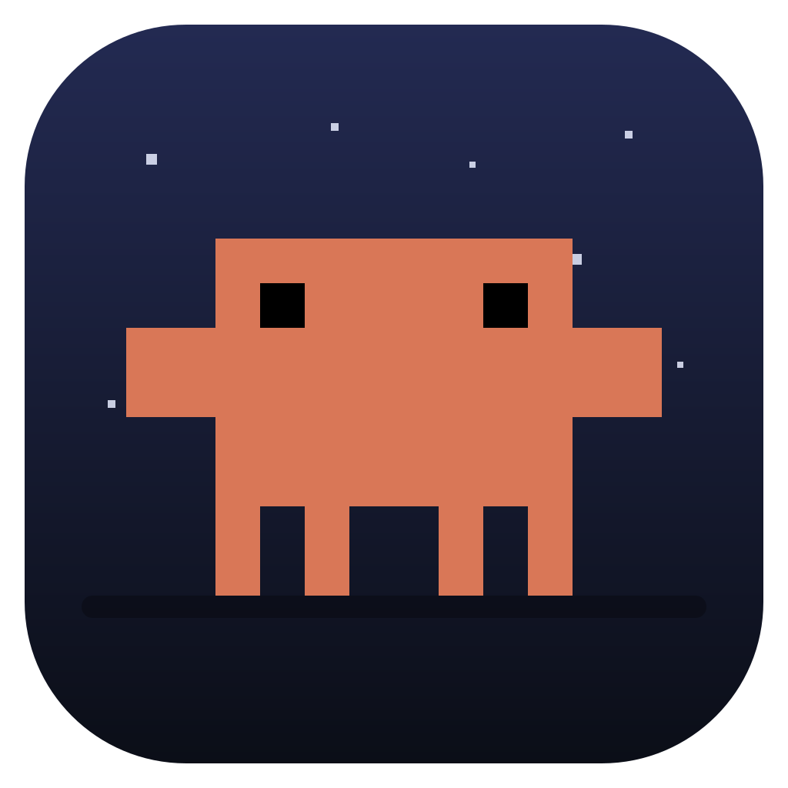
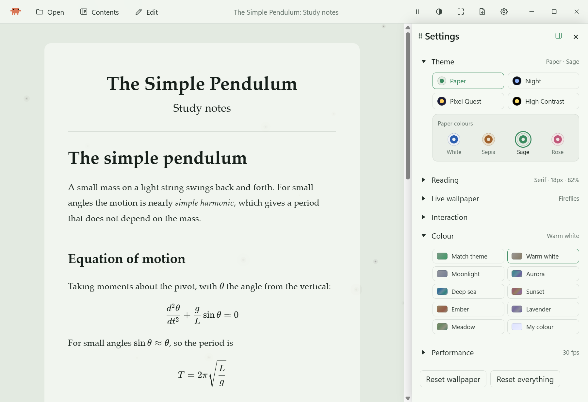

<p align="center">
  
</p>

<h1 align="center">MD Reader</h1>

<p align="center">
  A calm desktop Markdown reader for Windows.<br />
  Your document sits on a quiet reading column while a <b>live wallpaper</b> drifts behind it.
</p>

<p align="center">
  
</p>

MD Reader is made for long reading sessions: study notes, documentation, books written in Markdown. It renders maths, figures and tables properly, gives you a PDF-style contents sidebar, and lets you edit and save when you need to. When your eyes need a break, the background is something to look at: a starfield, fireflies, slow currents, rain on a pond, or a pixel-art world where **Claw'd** the crab wanders between places.

It is a real desktop app built with [Tauri](https://tauri.app), so it uses Windows' built-in WebView2 instead of shipping a whole browser. It's small, opens instantly and stays light on battery.

## Screenshots

| Pixel world (Pixel Quest theme) | Study notes with the contents panel |
| --- | --- |
|  |  |

| Light theme with settings docked |
| --- |
|  |

## Features

### Reading
- Open with the **Open** button, drag a file onto the window, or paste Markdown with `Ctrl+V`.
- **Maths** with KaTeX: `$inline$` and `$$ display $$` equations, with optional numbers like `$$[3.5]`.
- **Numbered figures** from images that sit alone in a paragraph. The alt text becomes the caption, and `{width=70}` sets the size. Pictures next to the file load straight from disk.
- **Table captions** with a `Table: …` line above a table, plus a **title block** from `% title:` / `% subtitle:` lines.
- Syntax-highlighted code, task lists, block quotes, reading time and a progress bar.
- **Contents panel** like a PDF viewer's sidebar: collapsible chapters that follow your place, and a Figures tab with thumbnails.
- The page **fits the window** (adjustable width), with an optional comfortable line length.
- Your last document and scroll position are remembered.

### Editing
- Documents always open for reading. Press **Edit** and the page becomes its Markdown source.
- The button becomes **Save**, and its ▾ menu has **Save as…** and **Stop editing**.
- Saving is safe: it writes to a temporary file first and keeps your file's line endings.
- The app warns you before unsaved changes would be lost.

### Themes
- **Paper**, in White, Sepia, Sage and Rose.
- **Night**, in Indigo, Ocean, Forest, Purple, Ember (warm, low blue light) and Graphite.
- **Pixel Quest**: a chunky retro-game look with a pixel font.
- **High Contrast**.
- A one-click light/dark switch remembers your favourite of each.

### Live wallpapers
Each one has its own settings and colour palettes (Warm white, Moonlight, Aurora, Deep sea, Sunset, Ember, Lavender, Meadow, or your own colour).

| Wallpaper | Click | Double-click | Press and hold |
| --- | --- | --- | --- |
| **Starfield**: drifting, twinkling stars and shooting stars | Ripple | Supernova | Gravity well (let go to slingshot) |
| **Fireflies**: warm tones, different sizes, slow blinking | Scatter | They all light up | They gather and circle you |
| **Flowing currents**: slow, soft trails | Swirl | A wide, slow whirlpool | Drag to stir the water |
| **Rain ripples**: rings spreading on a pond | Splash | A short thunder shower | Rest a finger in the water |
| **Pixel world**: Claw'd travels through six places | Claw'd hops | Fireworks, and Claw'd waves | Magic dust follows you |

The pixel world has six places: Green Meadow, Sunny Beach, Snowy Peaks, Desert Canyon, Autumn Woods and Under the Sea. It moves on every 30 minutes (adjustable) with a smooth crossfade, and the sky follows your clock.

### Comfortable to use
- A **pause button** for the moving background (`W`). The app also follows Windows' "reduce animations" setting.
- **Focus mode** calms the wallpaper and hides the toolbar until you need it.
- A frame-rate cap (15–60 fps). The wallpaper pauses when minimised and slows while you scroll.
- **Right-click** anywhere for a quick menu: theme, wallpaper, text size, page width and more.
- The toolbar is the window's title bar, with Windows-style controls.
- **Export to PDF**: clean pages without the wallpaper, each chapter on a new page.

## Keyboard shortcuts

| Key | Action |
| --- | --- |
| `O` / `Ctrl+O` | Open a file |
| `E` | Edit the document |
| `Ctrl+S` / `Ctrl+Shift+S` | Save / Save as (while editing) |
| `Esc` | Stop editing, or close panels |
| `C` | Contents panel |
| `S` / `Ctrl+,` | Settings |
| `T` | Switch light / dark |
| `F` | Focus mode |
| `W` | Pause or play the background |
| `P` / `Ctrl+P` | Export to PDF |

## Try the sample

[`docs/sample.md`](docs/sample.md) is a short set of study notes that shows off maths, a captioned table, code and a task list. Open it in the app.

## Building it yourself (Windows)

### One-time setup

1. Install [Node.js](https://nodejs.org) (LTS).
2. Install **Microsoft C++ Build Tools** with the *Desktop development with C++* workload:
   ```bash
   winget install Microsoft.VisualStudio.2022.BuildTools --override "--wait --passive --add Microsoft.VisualStudio.Workload.VCTools --includeRecommended"
   ```
3. Install **Rust**:
   ```bash
   winget install Rustlang.Rustup
   ```
4. Install the project's dependencies:
   ```bash
   npm install
   ```

### Run

```bash
npm run app        # the desktop app, reloads as you change the code
npm run dev        # browser-only preview at http://localhost:5173
```

### Build the installer

```bash
npm run app:build
```

The installers appear in `src-tauri/target/release/bundle/` (an `.exe` setup and an `.msi`).

## Project layout

```
src/
  main.ts                 app wiring: documents, toolbar, shortcuts, drag & drop, window
  markdown.ts             Markdown -> safe HTML: maths, figures, captions, task lists
  desktop.ts              desktop-only helpers: open/save dialogs, reading and writing files
  settings.ts             typed settings with defaults, saved locally
  themes.ts               theme families and their colour variations
  ui/
    editor.ts             edit mode, Save / Save as
    contents.ts           contents sidebar (chapters and figures)
    settingsPanel.ts      settings panel, built from a list of controls
    floating.ts           movable / dockable panels
    quickMenu.ts          right-click menu
    icons.ts              toolbar and window icons
    about.ts              About box
  wallpaper/
    host.ts               runs the active wallpaper: fps cap, pause, reduced motion, gestures
    palettes.ts           colour palettes
    starfield.ts  fireflies.ts  currents.ts  rain.ts
    pixel/                the pixel world: places, scenery, weather and Claw'd
  styles/                 app, Markdown and print (PDF) styles
src-tauri/                desktop wrapper (Rust): file access, window, installer
docs/                     sample document and screenshots
```

## Roadmap

- [ ] Reload automatically when the file changes on disk
- [ ] Recent files
- [ ] Find in document (`Ctrl+F`)
- [ ] Open `.md` files by double-clicking them in Explorer
- [ ] Ready-made installers on the Releases page
- [ ] Gentle ambient sounds to match each wallpaper

## Credits

Claw'd, the Claude crab, is Anthropic's character. This is an unofficial, fan-made project and is not affiliated with or endorsed by Anthropic.

Built with [Tauri](https://tauri.app), [Vite](https://vite.dev), [markdown-it](https://github.com/markdown-it/markdown-it), [KaTeX](https://katex.org), [highlight.js](https://highlightjs.org), [DOMPurify](https://github.com/cure53/DOMPurify) and [Pixelify Sans](https://fonts.google.com/specimen/Pixelify+Sans). The settings icon is adapted from [Feather Icons](https://feathericons.com) (MIT).
