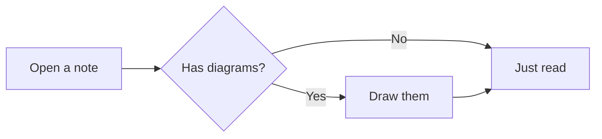
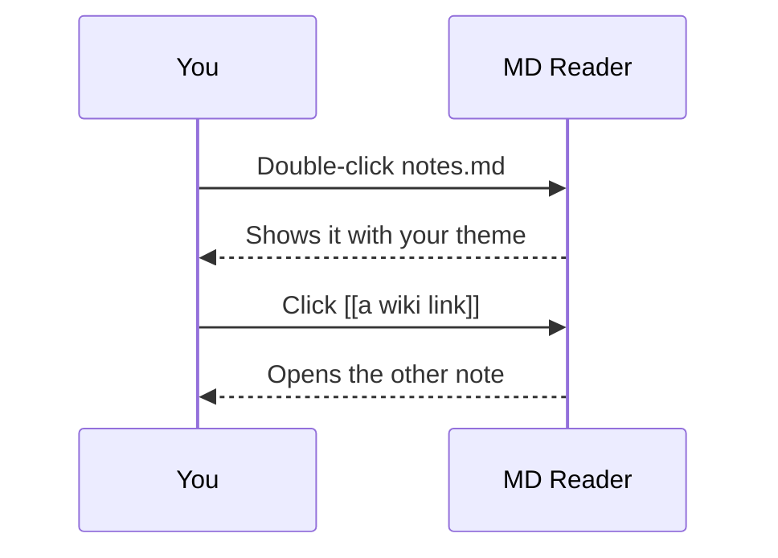
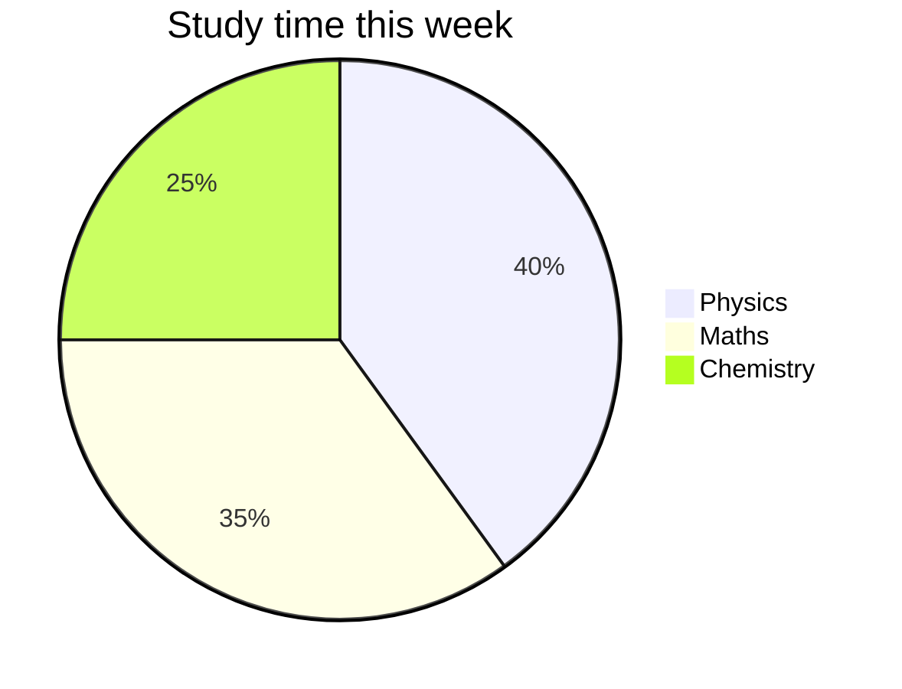

# Markdown formats tour

This note shows each format MD Reader understands, with the Markdown that makes it. The front matter at the top of this file (between the `---` lines) is hidden, and its title is used for the title block.

## Diagrams (Mermaid)

Write a ` ```mermaid ` code block. Flowcharts, sequence diagrams, timelines, mind maps, Gantt and pie charts all work, offline.







## Callouts

> [!NOTE]
> Useful information, written `> [!NOTE]`.

> [!TIP] Remember this
> A tip with its own title: `> [!TIP] Remember this`.

> [!IMPORTANT]
> Key information people need to know.

> [!WARNING]
> Something to be careful about.

> [!CAUTION]
> Possible bad results of an action.

> [!question]- Click to open (Obsidian style)
> Add `-` after the type to make it folded, or `+` to make it open but foldable.

## Footnotes

Light bends when it enters glass[^1], and the amount depends on its colour[^colour].

[^1]: This is called refraction.
[^colour]: Footnotes can have names instead of numbers.

## Highlight, subscript and superscript

- ==Highlighted text== is written `==Highlighted text==`.
- Water is H~2~O (`H~2~O`), and E = mc^2^ (`mc^2^`).

## Maths and chemistry

Inline maths like $a^2 + b^2 = c^2$, or a GitHub-style block:

```math
\int_0^\infty e^{-x^2}\,dx = \frac{\sqrt{\pi}}{2}
```

Chemistry with `\ce{...}`: $\ce{CO2 + H2O <=> H2CO3}$ and $\ce{Fe^{3+} + 3OH- -> Fe(OH)3 v}$.

## Emoji

`:rocket:` :rocket: `:books:` :books: `:white_check_mark:` :white_check_mark: `:bulb:` :bulb:

## Definition lists

Refraction
: Light changing direction when it passes into another material.

Reflection
: Light bouncing back from a surface.

## Wiki links

Link to another note in the same folder with `[[sample]]`: [[sample]].
Link to a heading in it with `[[sample#Measured periods]]`: [[sample#Measured periods]]. Give a link its own text with `[[sample|the pendulum notes]]`: [[sample|the pendulum notes]], or jump inside this note with `[[#Callouts]]`: [[#Callouts]].

Press **Alt + ←** (or your mouse's back button) to come back.
